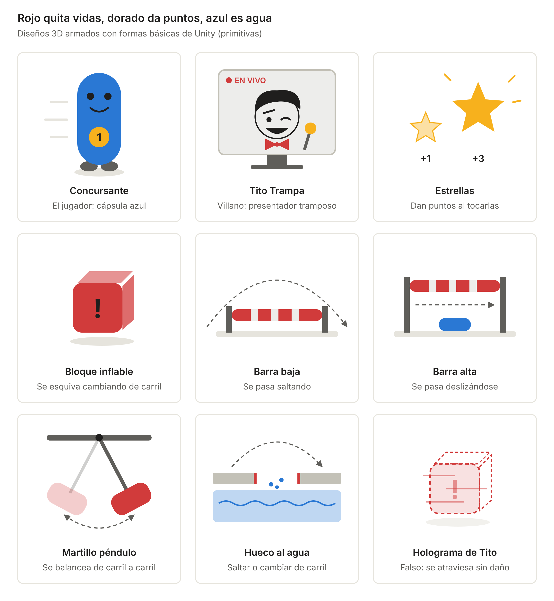
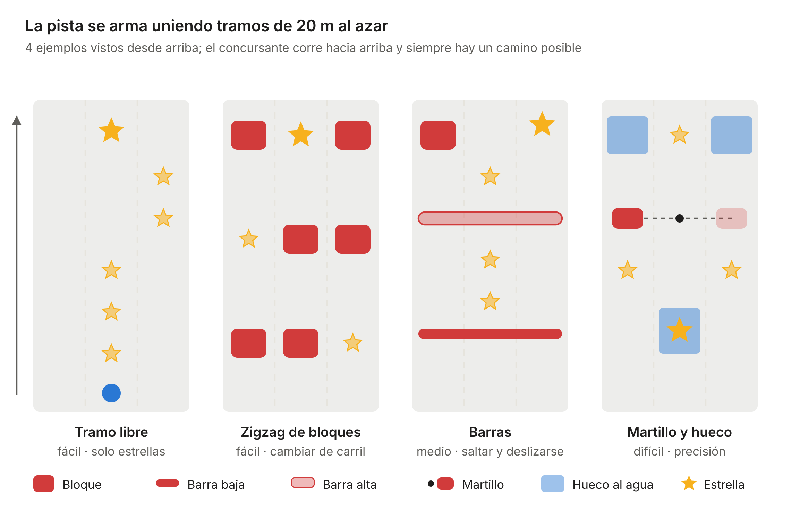
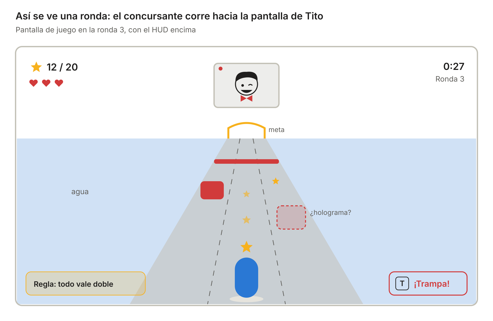
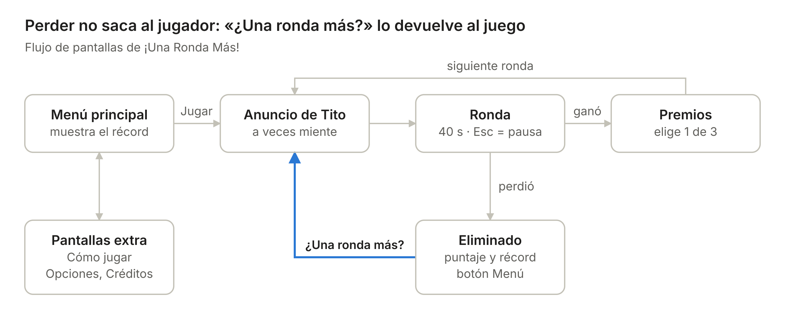
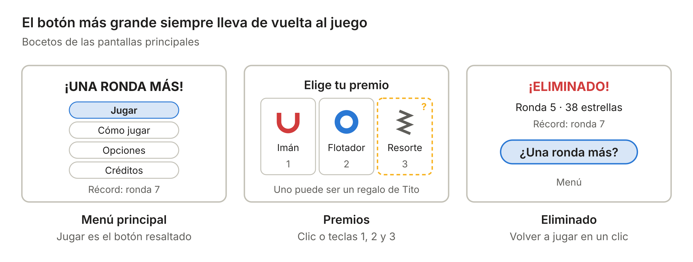

# ¡Una Ronda Más! — Diseño del juego y reparto de tareas

**¡Una Ronda Más!** es un concurso de obstáculos de TV en 3D: el concursante corre por una pista inflable sobre el agua, junta estrellas y esquiva trampas mientras el presentador, Tito Trampa, hace trampa. Cumple dos temas de la GameJamPlus 26/27, One More Time y Something's Off, y se hace con Unity 2022.3 LTS (C#) y herramientas gratuitas.

## La idea en 30 segundos

Es un concurso de obstáculos de televisión: corres 40 segundos por una pista inflable sobre una piscina, juntas estrellas y esquivas trampas, y el presentador hace trampa para que pierdas.

- **Para cualquier persona:** «Eres concursante en un programa de TV. Corres por una pista llena de obstáculos inflables; si chocas o te caes al agua, pierdes una vida. El presentador, Tito Trampa, cambia las reglas cada ronda y a veces miente.»
- **Para el jurado:** runner roguelite de rondas cortas ambientado en un concurso de TV. La pista se arma al azar en cada intento, cada victoria da un premio y cada derrota lleva a un solo botón: «¿Una ronda más?».
- **En inglés, para el pitch:** *A TV game show obstacle run where the host cheats — and never lets you leave.*

**Por qué engancha incluso a quien no juega**

- Todos conocen los concursos de obstáculos de TV, y caerse al agua da risa en lugar de frustrar.
- Se juega con tres acciones: cambiar de carril, saltar y deslizarse.
- Las rondas duran 40 segundos y reintentar es inmediato.
- El presentador tramposo da curiosidad por ver qué inventa después.

**Cómo cumple los temas**

- **One More Time:** pista distinta en cada intento, premios que se acumulan, récord guardado y reinicio con un clic.
- **Something's Off:** el presentador miente sobre las reglas, pone obstáculos falsos y el menú cambia según cuántas veces jugaste.

## Lo que lo hace divertido

Además de esquivar, el jugador toma una decisión importante en cada ronda; ahí están la diversión y el diferencial del juego.

| Mecánica | Cómo funciona | Por qué divierte |
| --- | --- | --- |
| Botón «¡Trampa!» | Si crees que Tito mintió sobre la regla, presionas T durante la ronda. Si aciertas ganas 5 estrellas y a Tito se le cae el peluquín; si te equivocas pierdes 1 vida. Una vez por ronda. | El jugador observa, sospecha y arriesga; la mentira se vuelve un juego |
| Premios envenenados | Desde la ronda 4, uno de los 3 premios puede ser un regalo de Tito con un efecto oculto que se revela al elegirlo | Elegir premio deja de ser obvio |
| La apuesta de Tito | Antes de cada ronda puedes apostar: la meta sube 50%, pero si ganas eliges 2 premios | Riesgo y recompensa en cada ronda |
| Obstáculos falsos | Cuando Tito miente, algunos obstáculos son hologramas que se pueden atravesar | La sorpresa de «Espera, ¿qué?» |
| Caídas al agua | Al caer, el concursante salpica, Tito se ríe y el jugador reaparece en la pista | Perder da risa en lugar de frustrar |

## Cómo se juega

El concursante corre solo hacia adelante; el jugador elige el carril, salta y se desliza para esquivar obstáculos y juntar estrellas antes de llegar a la meta.

**Controles**

| Acción | Teclado | Mando (extra) |
| --- | --- | --- |
| Cambiar de carril | A / D o flechas izquierda y derecha | Stick izquierdo |
| Saltar | Espacio o W | Botón A |
| Deslizarse | S o flecha abajo | Botón B |
| Acusar a Tito («¡Trampa!») | T | Botón Y |
| Pausa | Esc | Start |
| Elegir premio o apuesta | Clic o teclas 1, 2 y 3 | Cruceta y botón A |

**Reglas base**

- La pista tiene 3 carriles sobre el agua y cada ronda dura 40 segundos hasta la meta.
- La meta de estrellas empieza en 10 y sube 5 por ronda (10, 15, 20…).
- Estrella normal: 1 punto. Estrella dorada: 3 puntos; suele estar en lugares arriesgados.
- El jugador empieza con 3 vidas. Chocar con un obstáculo o caer al agua quita 1 vida; el concursante reaparece en el carril central con 1 segundo de invulnerabilidad.
- Si llega a la meta sin las estrellas necesarias o se queda sin vidas, queda eliminado.

**Una partida, paso a paso**

1. Tito anuncia la ronda y, desde la ronda 3, una regla especial. El jugador decide si acepta la apuesta.
2. El concursante corre 40 segundos: cambia de carril, salta, se desliza y junta estrellas.
3. Si cree que Tito mintió, el jugador lo acusa con «¡Trampa!».
4. Si llega a la meta con las estrellas necesarias, elige 1 de 3 premios (2 si ganó la apuesta) y pasa a una ronda más rápida.
5. Si queda eliminado, ve la ronda alcanzada, sus estrellas totales y el récord, con el botón «¿Una ronda más?».

El puntaje final es la suma de estrellas de todas las rondas. Todos los números son el punto de partida y se ajustan en el balance del domingo.

## Ronda por ronda

La ronda 3 es la primera con regla especial y desde la ronda 4 Tito puede mentir; cada ronda la pista va 8% más rápido y la meta sube 5 estrellas.

| Ronda | Meta | Velocidad | Obstáculos que aparecen | Tito |
| --- | --- | --- | --- | --- |
| 1 | 10 | 8 m/s | Bloques y barras bajas | Explica cómo se juega |
| 2 | 15 | 8,6 m/s | Se suman las barras altas | Sin regla especial |
| 3 | 20 | 9,3 m/s | Se suma el martillo | Primera regla, siempre verdadera |
| 4 | 25 | 10,1 m/s | Se suman los huecos al agua | Puede mentir; aparecen hologramas y premios envenenados |
| 5 | 30 | 10,9 m/s | Tramos medios | Puede mentir |
| 6 | 35 | 11,8 m/s | Tramos medios | Puede mentir |
| 7 | 40 | 12,7 m/s | Tramos medios y difíciles | Puede mentir |
| 8 | 45 | 13,7 m/s | Tramos difíciles | Puede mentir |
| 9 | 50 | 14,8 m/s | Tramos difíciles | Puede mentir |
| 10 | 55 | 16 m/s | Tramos difíciles | Final falso «FIN DEL PROGRAMA» (extra) |

Desde la ronda 11 la velocidad se queda en 16 m/s y solo sube la meta.

**Ejemplo: la ronda 3**

1. Tito aparece en la pantalla gigante: «¡Ronda 3! Meta: 20 estrellas. Y hoy… ¡todo vale doble!».
2. Tito ofrece su apuesta; el jugador la rechaza para ir seguro.
3. La regla se aplica: cada estrella vale el doble, pero la pista va 30% más rápido.
4. El jugador ya tiene 2 premios, por ejemplo Imán y Flotador. Aparece el primer martillo gigante.
5. Si llega a la meta con 20 estrellas, elige otro premio y pasa a la ronda 4, donde Tito ya puede mentir.

## Contenido del juego

El MVP necesita 5 obstáculos, 6 premios, 4 premios envenenados y 5 reglas; lo marcado como Extra se agrega solo si sobra tiempo.

**Obstáculos** (todos inflables y rojos)

| Obstáculo | Cómo se esquiva | Desde | Nivel |
| --- | --- | --- | --- |
| Bloque inflable | Cambiar de carril | Ronda 1 | MVP |
| Barra baja | Saltar | Ronda 1 | MVP |
| Barra alta | Deslizarse | Ronda 2 | MVP |
| Martillo péndulo | Pasar cuando el martillo está en otro carril | Ronda 3 | MVP |
| Hueco al agua | Saltar o cambiar de carril | Ronda 4 | MVP |
| Pelota rodante | Cambiar de carril; viene de frente | Ronda 5 | Extra |
| Rodillo giratorio | Saltar en el momento justo; barre los 3 carriles | Ronda 6 | Extra |

**Premios** (se elige 1 de 3 al ganar una ronda; se acumulan)

| Premio | Efecto | Nivel |
| --- | --- | --- |
| Corazón extra | +1 vida, máximo 5 | MVP |
| Imán | Atrae las estrellas de los carriles vecinos | MVP |
| Flotador | La primera caída al agua de cada ronda no quita vida | MVP |
| Escudo | Absorbe 1 choque por ronda | MVP |
| Resorte | Salto más alto y más largo | MVP |
| Cámara lenta | La pista va 10% más lenta | MVP |
| Trébol | Aparecen más estrellas doradas | Extra |
| Lupa | El cartel de Tito da una pista extra cuando miente | Extra |

**Premios envenenados** (desde la ronda 4, uno de los 3 puede serlo; tiene un brillo raro como pista)

| Parece | En realidad |
| --- | --- |
| Corazón extra | Da la vida, pero la meta de la siguiente ronda sube 5 |
| Resorte | Cada salto es doble y cuesta caer donde quieres |
| Cámara lenta | Hace lento el cambio de carril, no la pista |
| Escudo | Solo dura los primeros 10 segundos de la ronda |

**Reglas de Tito** (una por ronda desde la ronda 3)

| Regla | Qué pasa | Nivel |
| --- | --- | --- |
| Todo vale doble | Las estrellas valen el doble, pero la pista va 30% más rápido | MVP |
| Apagón | La pista se oscurece; solo se ve lo que ilumina el reflector del concursante | MVP |
| Espejo | Izquierda y derecha se invierten | MVP |
| Gigante | El concursante es el doble de grande y no puede deslizarse bajo las barras altas | MVP |
| Sin salto | No se puede saltar en toda la ronda | MVP |
| Estrellas tímidas | Las estrellas cambian de carril cuando te acercas | Extra |
| Lluvia de estrellas | Aparecen el doble de estrellas y el doble de obstáculos | Extra |
| Viento | Un ventilador gigante empuja al concursante hacia un lado | Extra |

## Diseño de personajes y obstáculos (3D)

Todo se arma con formas básicas de Unity (primitivas) y colores fijos, así que no hace falta saber modelar: rojo quita vidas, dorado da puntos y azul es agua.

| Diseño | Cómo se arma en Unity | Colores | Animaciones |
| --- | --- | --- | --- |
| Concursante (jugador) | Capsule de 1,6 m como cuerpo, dos Spheres como ojos, una sonrisa, un Cylinder delgado con el número 1 (TextMeshPro) en el pecho y dos Capsules chicas como pies | Azul, número dorado, ojos negros | Corre balanceándose, se encoge al saltar, se aplasta al deslizarse, salpica al caer al agua y salta de alegría en la meta |
| Tito Trampa (villano) | Cara en la pantalla gigante al fondo: Canvas en World Space con Images de círculos y rectángulos, sobre un Cube delgado | Pelo negro (es un peluquín), moño rojo, micrófono dorado | Sonrisa, guiño, risa tramposa, pantalla que tiembla cuando miente y peluquín que sale volando cuando lo descubren |
| Estrellas | Malla de estrella de 5 puntas extruida, generada por script (`StarMeshBuilder`) o hecha con ProBuilder | Normal amarilla clara (+1), dorada grande (+3) | Giran, flotan y destellan al recogerlas |
| Bloque inflable | Cube de 2 × 2 × 2 m (bordes redondeados con ProBuilder, opcional) y un signo «!» con TextMeshPro | Rojo | Se infla y desinfla un poco, como si respirara |
| Barra baja | Cylinder horizontal a 50 cm del piso entre dos postes (Cylinders) | Roja con franjas claras | Vibra al chocarla |
| Barra alta | Cylinder horizontal a 1,2 m del piso entre dos postes (Cylinders) | Roja con franjas claras | Vibra al chocarla |
| Martillo péndulo | Cylinder grande colgado de una viga (Cube), con un pivote vacío que gira por script (`HammerSwing`) de un carril a otro | Rojo, viga gris | Balanceo constante con una onda seno |
| Hueco al agua | Un pedazo de carril sin piso, con agua debajo y un trigger `WaterZone` | Agua azul, borde rojo | El agua ondula; salpicadura al caer |
| Holograma de Tito | Copia de un obstáculo con material Standard en modo Fade (semitransparente) y `isFake = true` | Rojo transparente que parpadea | Tiembla un poco; se atraviesa sin daño |

**Personalidad**

- **Tito Trampa:** presentador encantador y tramposo. Habla como en un concurso de TV («¡Un aplauso para el concursante!»), nunca se enoja y sonríe más cuando el jugador cae al agua.
- **Concursante:** no tiene nombre ni habla; el jugador es el concursante número 1 y se expresa con saltos y gestos.

## La pista (escenario 3D)

La pista es un recorrido inflable de 3 carriles sobre una piscina dentro del estudio de TV; se arma uniendo al azar tramos de 20 m, así cada intento es distinto.

- **Tramos:** cada tramo es una escena de 20 m con obstáculos y estrellas ya ubicados. Hay tramos fáciles, medios y difíciles; el generador elige según la ronda.
- **Cantidad:** a 8 m/s, la ronda 1 recorre 320 m en 40 segundos, es decir 16 tramos; la ronda 10 recorre 640 m, 32 tramos.
- **Para el MVP bastan 12 tramos:** 4 fáciles, 4 medios y 4 difíciles. Siempre debe haber un camino posible.
- **Meta:** un arco inflable dorado al final de los 40 segundos, con confeti al cruzarlo.
- **El estudio:** agua azul a los lados, focos de colores, público plano al fondo (extra) y la pantalla gigante de Tito al final de la pista.

**Así se ve el juego**

La cámara va detrás y por encima del concursante, mirando hacia adelante; la pantalla de Tito siempre está al fondo, así el jugador lo ve mientras corre.

## El giro: algo no está bien

Lo extraño aparece desde la ronda 3 de la primera partida, porque los jurados suelen jugar solo una o dos veces; después, el juego guarda cuántas partidas jugaste y sigue cambiando.

| Momento | Qué pasa |
| --- | --- |
| Rondas 1 y 2 | Todo normal. Tito es amable y explica las reglas. |
| Desde la ronda 3 | Tito anuncia una regla especial en cada ronda y ofrece su apuesta. |
| Desde la ronda 4 | Tito puede mentir (30%): anuncia una regla y aplica otra, y pone hologramas en la pista. El cartel de la regla tiembla cuando miente. Como extra, un cartel falso de «¡Atajo!» que lleva al agua. |
| Segunda partida | Tito te reconoce («Ah, volviste») y el botón «Jugar» pasa a decir «¿Una ronda más?». |
| Desde la tercera partida | El título del menú tiembla y Tito comenta tus derrotas anteriores («Ya van 3, ¿eh?»). |
| Ronda 10 (extra) | Se apagan las luces y aparece «FIN DEL PROGRAMA». Segundos después, Tito dice «Mentí. Una ronda más» y empieza la ronda 11. |

- **La broma nunca atrapa al jugador:** en la versión de escritorio, la primera vez que pulsa «Salir», Tito pregunta «¿De verdad te vas?», pero salir siempre funciona.
- **La mentira tiene pistas:** el cartel tiembla y los hologramas parpadean; el jugador atento la descubre y la acusa con «¡Trampa!».
- **Frases de Tito:** entre 25 y 35 frases cortas, agrupadas por momento: inicio de ronda, regla, apuesta, caída al agua, acusación acertada, acusación fallida, victoria y eliminación.

## Menús y pantallas

El juego tiene 9 pantallas; tras perder, el botón principal es «¿Una ronda más?», que reinicia en la ronda 1 sin pasar por el menú.

**Cómo se ven las pantallas principales**

La pausa se abre con Esc durante cualquier ronda y vuelve al mismo punto.

| Pantalla | Contenido | Notas |
| --- | --- | --- |
| Menú principal | Jugar, Cómo jugar, Opciones, Créditos y Salir; récord visible | En la versión web se oculta Salir, porque el navegador no permite cerrar el juego |
| Cómo jugar | Controles, objetivo y una imagen | Máximo 4 líneas de texto |
| Opciones | Volumen de música, volumen de efectos y pantalla completa | Se guardan con el SaveManager |
| Créditos | Equipo y licencias de los assets | Obligatorio si algún asset es CC-BY |
| Anuncio de Tito | Número de ronda, meta, regla especial y la apuesta (aceptar o rechazar) | Avanza al elegir |
| HUD | Estrellas y meta, tiempo, vidas, ronda, regla activa y aviso de «¡Trampa!» disponible | Siempre visible durante la ronda |
| Premios | 3 tarjetas con nombre, ícono y efecto; un regalo de Tito puede estar escondido | Clic o teclas 1, 2 y 3 |
| Pausa | Continuar, Reiniciar, Opciones y Menú principal | Detiene la ronda |
| Eliminado | Ronda alcanzada, estrellas totales y récord; botones «¿Una ronda más?» y Menú | «¿Una ronda más?» es el botón grande y viene seleccionado |

## Versión 3D en Unity

El juego se ve en 3D, pero la lógica es la de un runner: el concursante solo cambia entre 3 carriles, salta y se desliza, y la pista se mueve hacia él.

| Elemento | Cómo se hace en Unity 2022.3 |
| --- | --- |
| Render | Built-in Render Pipeline con shader Standard; funciona bien en WebGL |
| Movimiento | El concursante se queda en z = 0 y los tramos avanzan hacia −Z a la velocidad de la ronda |
| Carriles | Tres posiciones fijas en X (−2, 0 y 2 m); el cambio de carril se anima por código en 0,15 s |
| Salto y deslizamiento | Salto con una curva simple en Y calculada por código; al deslizarse, la cápsula baja a ~0,7 m durante 0,6 s |
| Colisiones | Obstáculos, estrellas y agua con colliders en modo Trigger; concursante con Rigidbody cinemático |
| Tramos | Prefabs de 20 m que el `TrackGenerator` crea adelante y destruye al pasar detrás de la cámara |
| Cámara | Camera fija en (0, 4, −7) mirando hacia adelante; niebla del color del fondo para ocultar la aparición de tramos |
| Luces | Una Directional Light suave, Spot Lights de colores a los lados y luz ambiental en modo Color |
| Agua | Plane grande con material Standard en modo Fade, azul semitransparente |
| Apagón | Luz ambiental casi en negro, Directional Light apagada y una Spot Light que sale del concursante hacia adelante |
| Partículas | Particle System para salpicaduras, confeti y destellos |
| Interfaz | Canvas de uGUI con TextMeshPro encima del juego; la cara de Tito en un Canvas World Space |
| Guardado | `PlayerPrefs` (en WebGL se guarda en el navegador) |

**Reglas para que el 3D no complique el trabajo**

- El concursante nunca avanza: se mueve la pista. Así todo es más fácil de probar.
- Escala real: 1 unidad = 1 metro. El concursante mide 1,6 m, cada carril 2 m y cada tramo 20 m.
- Un material por color de la paleta, reutilizado en todos los objetos.
- La build WebGL se prueba el sábado con la escena casi vacía, no el domingo con el juego terminado.
- En WebGL el audio empieza recién después del primer clic del jugador; el menú principal lo resuelve.
- Las fuentes de TextMeshPro se crean en modo Dynamic para que salgan tildes, ñ, ¡, ¿ y «».

## Herramientas gratis para ir más rápido

Todo el juego se puede hacer sin pagar nada.

| Para qué | Herramienta | Por qué ayuda |
| --- | --- | --- |
| Motor del juego | Unity 2022.3 LTS (Personal) con el módulo WebGL Build Support | Gratis; exporta al navegador para itch.io |
| Escribir código | Claude Code + Visual Studio Community o VS Code con la extensión de Unity | Autocompletado y depuración de C# |
| Código compartido | GitHub con GitHub Desktop | Repositorio privado gratis; evita pelear con comandos de Git |
| Formas 3D | Primitivas de Unity; ProBuilder (paquete gratis) para bordes redondeados | Sin modelar nada |
| Modelos 3D (opcional) | Kenney y Quaternius | Licencia CC0: se usan sin pedir permiso |
| Efectos de sonido | jsfxr y los packs de audio de Kenney | Sonidos arcade listos en segundos |
| Música | OpenGameArt, filtrando por CC0 | Música lista para usar |
| Editar audio | Audacity | Cortar, nivelar volumen y exportar a OGG |
| Tipografías | Google Fonts | Licencia OFL, se pueden usar en juegos |
| Tareas del equipo | GitHub Projects o Trello | Tablero con las tareas de `docs/PLAN.md` |
| Comunicación | Discord | Llamada y pantalla compartida mientras trabajan |
| Grabar gameplay | OBS Studio | Graba la pantalla en buena calidad para el pitch |
| Editar el video | DaVinci Resolve o CapCut | Sus versiones gratuitas alcanzan para un video de 3 a 5 minutos |
| Diapositivas | Google Slides o Canva | Plantillas gratis para el pitch |
| Publicar el juego | itch.io | Hospeda la versión WebGL gratis y es la plataforma que pide la jam |

## Arte y sonido sin saber diseñar

El juego se ve bien sin dibujar nada: packs gratuitos, una paleta fija de colores y mucho movimiento.

| Recurso | Para qué | Licencia |
| --- | --- | --- |
| Kenney (kenney.nl) | Modelos 3D opcionales, íconos de interfaz y sonidos | CC0, sin obligación de dar créditos |
| Quaternius (quaternius.com) | Personajes y objetos 3D low-poly con animaciones | CC0 |
| Google Fonts | Tipografías para títulos y textos | OFL, uso libre en juegos |
| jsfxr | Generar efectos de sonido arcade desde el navegador | Sonidos generados por el equipo |
| OpenGameArt (opengameart.org) | Música de fondo | Variable: filtrar por CC0 o CC-BY y dar crédito |

Revisar la licencia de cada pack al descargarlo y anotarla en la pantalla de Créditos.

**Reglas de estilo**

- Paleta fija de 5 colores: fondo oscuro (morado o azul noche), dorado para estrellas, rojo para peligros, azul para el jugador y blanco para textos.
- El color comunica: rojo siempre es peligro y dorado siempre es puntos.
- Una tipografía para títulos y otra para textos, nada más.
- La pista se arma con formas simples: cajas y cilindros inflables de colores, agua azul a los lados, focos y un letrero con el nombre del programa.
- La sensación de calidad viene del movimiento: partículas al recoger estrellas, sacudida de cámara al recibir un golpe y botones que crecen al pasar el mouse.

**Atajos para ganar tiempo**

- Usar las primitivas de Unity en lugar de buscar modelos: se ve coherente y no hay que importar nada.
- Hacer primero un tramo como plantilla (prefab) y duplicarlo para armar los demás.
- Crear materiales, prefabs base y datos con scripts de Editor (menú «Una Ronda Más/...») en lugar de hacerlos a mano.
- No reutilizar código de proyectos anteriores: el reglamento descalifica cualquier desarrollo previo.

## Alcance

Lo obligatorio debe estar listo el domingo a las 17:00; lo extra solo se empieza si el MVP ya funciona completo.

| Nivel | Incluye |
| --- | --- |
| MVP (obligatorio) | Concursante con carriles, salto y deslizamiento; 5 obstáculos; estrellas normales y doradas; 12 tramos; meta y tiempo por ronda; 6 premios y 4 premios envenenados; 5 reglas; mentiras de Tito con hologramas y botón «¡Trampa!»; apuesta; frases y cara de Tito; menú principal, Cómo jugar, Opciones, Créditos, anuncio de ronda, HUD, Premios, Pausa y Eliminado; récord guardado; menú que cambia desde la segunda partida; música y efectos básicos; build web |
| Extra (si sobra tiempo) | Pelota rodante y rodillo giratorio, 8 premios y 8 reglas, cartel falso de «¡Atajo!», final falso de la ronda 10, público animado, soporte de mando, interfaz en inglés |
| Fuera de alcance | Multijugador, progresión permanente entre partidas, varios escenarios, historia larga, voces grabadas |
